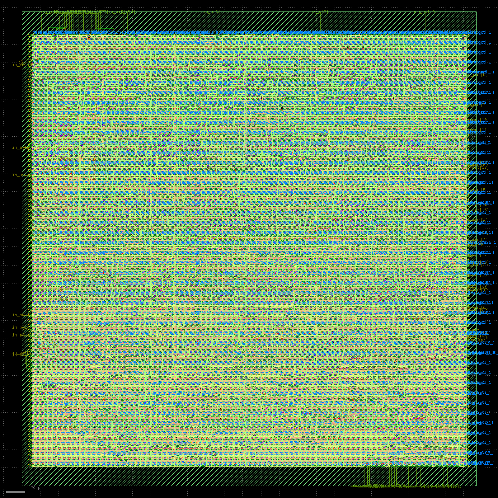

# MAC Accelerator: RTL-to-GDSII on SkyWater SKY130

[](https://github.com/botirkhan/mac-asic-sky130/actions/workflows/asic.yml)

This project takes the 3-stage pipelined signed **multiply-accumulate (MAC)** unit from [pipelined-mac-accelerator](https://github.com/botirkhan/pipelined-mac-accelerator) all the way from RTL to a **GDSII chip layout** on the open-source **SkyWater SKY130** 130 nm process. It uses the open-source **LibreLane** flow (the successor to OpenLane 2): Yosys, OpenROAD, OpenSTA, Magic, KLayout and Netgen.

The whole flow runs in **GitHub Actions** on every push, at three clock targets. Each run:

1. simulates the RTL against a C++ golden model,
2. builds the chip layout,
3. signs it off with multi-corner STA, DRC and LVS,
4. re-runs the same self-checking testbench on the **routed gate-level netlist**,
5. commits the measured numbers to [`docs/results.md`](docs/results.md).



## Results

The table in **[`docs/results.md`](docs/results.md)** is written by CI from LibreLane's `final/metrics.json`, so every number in it comes from a real run. For each clock target (10, 7 and 5 ns) it reports:

- setup WNS at the slow (ss, 100 °C, 1.60 V) and typical (tt, 25 °C, 1.80 V) corners, Fmax estimates, and hold WNS
- standard-cell area, cell count, die area and utilization
- power
- Magic and KLayout DRC counts, LVS errors and antenna violations
- the gate-level simulation result

The tightest clock target is meant to push past what the design can close, which shows where the timing limit is. That job is allowed to fail.

### SKY130 vs Artix-7

| | Artix-7 FPGA (xc7a100t, Vivado) | SKY130 ASIC (sky130_fd_sc_hd, LibreLane) |
|---|---|---|
| Multiplier and adder | Hard **DSP48E1** slice (all 3 stages packed inside) | Built from standard cells (16×16 multiplier and 40-bit adder) |
| Clock | 250 MHz met, WNS +0.874 ns (about 320 MHz) | See [`docs/results.md`](docs/results.md) |
| Cost | 1 DSP + 8 FFs | µm² of standard cells (see results) |
| Signoff | Vivado STA | Multi-corner OpenSTA, Magic and KLayout DRC, Netgen LVS |

On the FPGA the hard DSP block hides the multiplier's cost. On an ASIC every gate of the 16×16 multiplier and the 40-bit accumulator shows up as area, power and timing paths, which is why this comparison is worth making.

## Design (same RTL as the FPGA version)

| Item | Value |
|---|---|
| Operands | 16-bit signed |
| Product | 32-bit, full precision |
| Accumulator | 40-bit signed (8 guard bits: 511 worst-case products without overflow, then wraps mod 2⁴⁰) |
| Pipeline | S1 operand regs → S2 product reg → S3 accumulator, 3-cycle latency, 1 sample per clock |
| Framing | `in_first` restarts accumulation, and `in_last` marks the end of a dot product (`out_last`) |
| Reset | Synchronous on the valid/first/last control pipeline only. Datapath registers are clock-enabled by `valid` and have no reset |

The one RTL change from the FPGA repo is that the sign extension `AW'(p2)` is written as an explicit replication, `{{(AW-PW){p2[PW-1]}}, p2}`, so every tool in the open-source flow parses it the same way. The behavior is identical.

## Flow

```
rtl/mac_pipe.sv
   │  Yosys + ABC (synthesis to sky130_fd_sc_hd)
   ▼
OpenROAD: floorplan (40% core util) → PDN → global/detailed placement → CTS
        → resizer timing repair → global/detailed routing → parasitic extraction
   ▼
Signoff: OpenSTA (9 corners: ss/tt/ff × min/nom/max RC) · Magic DRC · KLayout DRC
        · Netgen LVS · antenna check · Magic/KLayout GDS XOR
   ▼
final/gds/mac_pipe.gds  +  final/nl/mac_pipe.nl.v
   │  Icarus Verilog + sky130 cell models (unit delay)
   ▼
Gate-level regression with the same vectors as RTL
```

Configuration lives in [`config.yaml`](config.yaml). CI overrides `CLOCK_PERIOD` for each matrix job.

## Verification

- **Golden model.** [`model/mac_model.cpp`](model/mac_model.cpp) generates directed and constrained-random dot products for each seed and computes the expected accumulator, wrapped to 40 bits. The directed cases cover max×max, min×min, alternating full-scale signs, exactly 511 worst-case products, and 513 (which must wrap).
- **Independent cross-check.** [`tools/check_model.py`](tools/check_model.py) recomputes every expected value with Python big integers before any simulation runs.
- **Portable self-checking bench.** [`tb/tb_mac_gl.v`](tb/tb_mac_gl.v) is plain Verilog-2005, so it runs on both the RTL and the SKY130 gate-level netlist. It drives on the falling edge and checks `acc_out` and `out_last` for every result. It also checks that each result arrives **exactly 3 cycles** after its sample, and it flags X/Z, unexpected outputs and hangs. Idle gaps (0–90%) carry random garbage operands that must be ignored.
- **RTL:** 8 seeds. **Gate level:** 3 seeds for every routed netlist. Results are in the CI job summaries.

## Running locally

You need Python 3.8+, Docker, Icarus Verilog and g++. On Windows, use WSL2.

```bash
pip install librelane==3.0.17
librelane --dockerized -c CLOCK_PERIOD=10 config.yaml       # → runs/<tag>/final/
bash scripts/run_sim.sh rtl 8                                 # RTL regression
bash scripts/run_sim.sh gl runs/<tag>/final/nl/mac_pipe.nl.v  # gate level
librelane --dockerized --last-run --flow OpenInKLayout config.yaml   # view layout
```

## Files

| Path | Contents |
|---|---|
| `rtl/mac_pipe.sv` | MAC RTL |
| `config.yaml` | LibreLane / SKY130 configuration |
| `tb/tb_mac_gl.v` | Self-checking testbench (RTL + gate level) |
| `model/mac_model.cpp` | C++ golden model and vector generator |
| `tools/check_model.py` | Independent Python model check |
| `scripts/run_sim.sh` | Icarus regression runner (RTL / GL) |
| `scripts/summarize.py` | Turns `metrics.json` from every run into `docs/results.md` |
| `scripts/render_layout.py` | KLayout batch render of the GDS |
| `.github/workflows/asic.yml` | CI: RTL sim → 3× RTL-to-GDSII → GL sim → results commit |

## License

MIT
